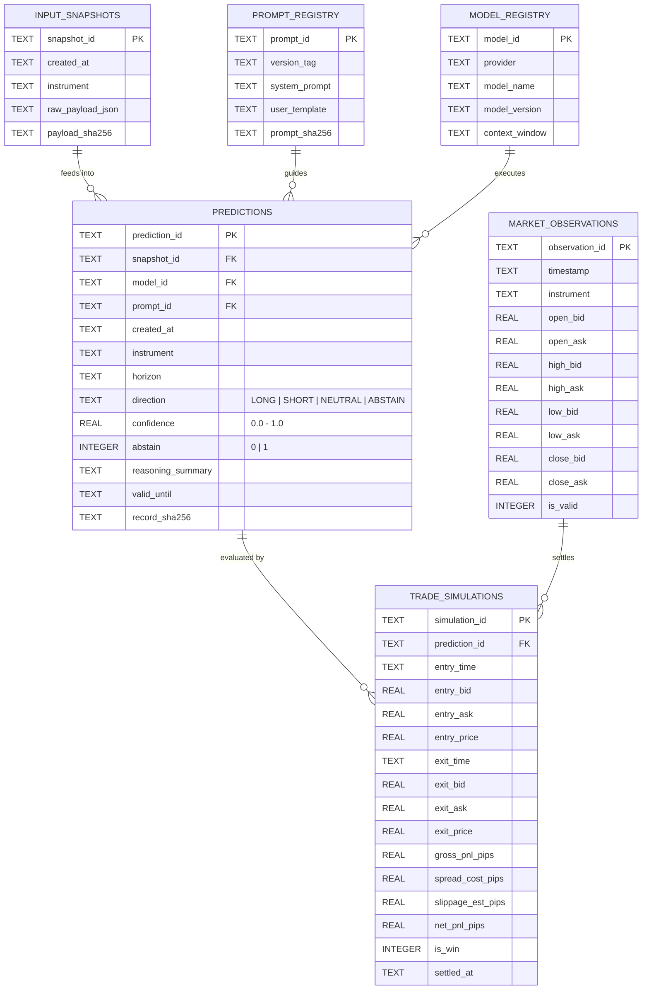
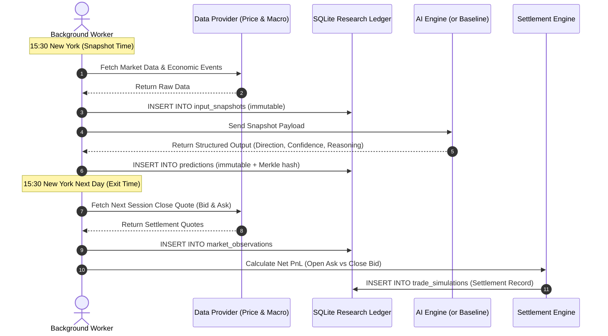

# Project O.R.A.C.L.E. — Data Dictionary & SQLite Research Ledger Specification
**Document ID:** P0-03-DATA-DICTIONARY  
**Version:** 0.1.0  
**Date:** 2026-11-10  
**Project Lead:** Dylan  
**Status:** Design Proposal (Đặc tả thiết kế kỹ thuật)

---

## 1. Triết lý Thiết kế: SQLite as a Research Ledger
Trong Project O.R.A.C.L.E., cơ sở dữ liệu SQLite không chỉ là kho chứa dữ liệu ứng dụng thông thường, mà đóng vai trò là một **Sổ cái Kiểm toán Nghiên cứu (Research Ledger)**. 

### Mục tiêu cốt lõi:
1. **Khả năng Tái lập (Reproducibility 100%):** Mọi dự đoán sinh ra đều phải truy ngược được chính xác:
   - Dữ liệu đầu vào tại thời điểm đó là gì (`input_snapshots`).
   - Phiên bản prompt và model nào đã được sử dụng (`prompt_registry`, `model_registry`).
2. **Tính Bất biến (Immutability):** Dữ liệu dự đoán và snapshot đầu vào một khi đã ghi thì không bao giờ được phép sửa đổi hoặc xóa bỏ (`Append-Only`).
3. **Phân tách Độc lập giữa Dự đoán và Kết quả:** Quá trình sinh nhận định (Prediction) và quá trình thanh toán kết quả thực tế (Settlement/Simulation) diễn ra ở hai thời điểm khác nhau và lưu ở hai bảng riêng biệt.

---

## 2. Kiến trúc Tổng thể Thực thể & Mối quan hệ (ERD)



---

## 3. Data Dictionary: Chi tiết từng Bảng dữ liệu

### 3.1 Bảng `input_snapshots` (Dữ liệu đầu vào bất biến)
Lưu toàn bộ dữ liệu thị trường và kinh tế mà hệ thống "nhìn thấy" tại thời điểm ra quyết định.

| Tên trường (Field) | Kiểu dữ liệu | Ràng buộc (Constraints) | Ý nghĩa nghiệp vụ |
| :--- | :--- | :--- | :--- |
| `snapshot_id` | `TEXT` | `PRIMARY KEY` | Định danh duy nhất (VD: `snap-20261110-1530-001`). |
| `created_at` | `TEXT` | `NOT NULL` | Thời điểm tạo snapshot (ISO-8601 UTC). |
| `instrument` | `TEXT` | `NOT NULL, CHECK (instrument = 'EURUSD')` | Cặp tiền tệ đang nghiên cứu. |
| `raw_payload_json` | `TEXT` | `NOT NULL` | Toàn bộ dữ liệu giá, tin tức, lịch kinh tế dạng JSON thô. |
| `payload_sha256` | `TEXT` | `NOT NULL` | Băm SHA-256 của `raw_payload_json` để phát hiện can thiệp. |

---

### 3.2 Bảng `model_registry` (Quản lý Model)
Quản lý định danh và phiên bản của mô hình LLM.

| Tên trường | Kiểu dữ liệu | Ràng buộc | Ý nghĩa |
| :--- | :--- | :--- | :--- |
| `model_id` | `TEXT` | `PRIMARY KEY` | Định danh nội bộ (VD: `mdl-gemini-2.5-flash-001`). |
| `provider` | `TEXT` | `NOT NULL` | Nhà cung cấp (VD: `google`, `openai`, `anthropic`). |
| `model_name` | `TEXT` | `NOT NULL` | Tên mô hình chính thức. |
| `model_version` | `TEXT` | `NOT NULL` | Phiên bản model cụ thể (VD: `gemini-2.5-flash-preview`). |
| `registered_at` | `TEXT` | `NOT NULL` | Thời điểm đưa model vào nghiên cứu. |

---

### 3.3 Bảng `prompt_registry` (Quản lý Prompt & Hashing)
Bảo đảm mọi dự đoán đều biết rõ được sinh ra bởi prompt nào.

| Tên trường | Kiểu dữ liệu | Ràng buộc | Ý nghĩa |
| :--- | :--- | :--- | :--- |
| `prompt_id` | `TEXT` | `PRIMARY KEY` | Định danh prompt (VD: `pmt-macro-v0.1.0`). |
| `version_tag` | `TEXT` | `NOT NULL UNIQUE` | Nhãn phiên bản semver (VD: `0.1.0`). |
| `system_prompt` | `TEXT` | `NOT NULL` | Toàn văn hướng dẫn hệ thống. |
| `user_template` | `TEXT` | `NOT NULL` | Template điền dữ liệu snapshot. |
| `prompt_sha256` | `TEXT` | `NOT NULL` | Băm SHA-256 của prompt để xác thực. |
| `created_at` | `TEXT` | `NOT NULL` | Ngày tạo prompt. |

---

### 3.4 Bảng `predictions` (Sổ cái Dự đoán Bất biến)
Bảng cốt lõi ghi nhận dự báo của AI hoặc các Baselines.

| Tên trường | Kiểu dữ liệu | Ràng buộc | Ý nghĩa |
| :--- | :--- | :--- | :--- |
| `prediction_id` | `TEXT` | `PRIMARY KEY` | Định danh dự đoán (VD: `pred-20261110-001`). |
| `snapshot_id` | `TEXT` | `NOT NULL, FK -> input_snapshots` | Liên kết đến snapshot đầu vào tương ứng. |
| `model_id` | `TEXT` | `NOT NULL, FK -> model_registry` | Model đã sinh ra dự đoán (hoặc `baseline-rule`). |
| `prompt_id` | `TEXT` | `NOT NULL, FK -> prompt_registry` | Prompt được sử dụng. |
| `created_at` | `TEXT` | `NOT NULL` | Dấu thời gian sinh dự đoán (ISO-8601 UTC). |
| `instrument` | `TEXT` | `NOT NULL, DEFAULT 'EURUSD'` | Cặp tiền tệ. |
| `horizon` | `TEXT` | `NOT NULL, DEFAULT '1D_SESSION'` | Khung thời gian dự báo. |
| `direction` | `TEXT` | `NOT NULL, CHECK (direction IN ('LONG', 'SHORT', 'NEUTRAL', 'ABSTAIN'))` | Hướng dự báo. |
| `confidence` | `REAL` | `NOT NULL, CHECK (confidence >= 0.0 AND confidence <= 1.0)` | Độ tự tin do model tự báo cáo. |
| `abstain` | `INTEGER` | `NOT NULL, CHECK (abstain IN (0, 1))` | Cờ chủ động từ chối dự đoán (1: Có, 0: Không). |
| `reasoning_summary`| `TEXT` | `NULL` | Giải thích lý do ngắn gọn. |
| `valid_until` | `TEXT` | `NOT NULL` | Hạn chót hiệu lực của dự báo. |
| `previous_hash` | `TEXT` | `NOT NULL` | Hash của bản ghi trước đó (Merkle chain). |
| `record_sha256` | `TEXT` | `NOT NULL UNIQUE` | Hash của chính dòng này để bảo vệ tính toàn vẹn. |

---

### 3.5 Bảng `market_observations` (Báo giá Thị trường Thực tế)
Lưu trữ giá OHLC Bid/Ask chuẩn hóa của từng phiên giao dịch để tính toán kết quả.

| Tên trường | Kiểu dữ liệu | Ràng buộc | Ý nghĩa |
| :--- | :--- | :--- | :--- |
| `observation_id` | `TEXT` | `PRIMARY KEY` | Định danh phiên (VD: `obs-20261110-1530`). |
| `timestamp` | `TEXT` | `NOT NULL UNIQUE` | Mốc thời gian 15:30 `America/New_York`. |
| `instrument` | `TEXT` | `NOT NULL, DEFAULT 'EURUSD'` | Cặp tiền tệ. |
| `open_bid` | `REAL` | `NOT NULL` | Giá mở cửa Bid. |
| `open_ask` | `REAL` | `NOT NULL` | Giá mở cửa Ask. |
| `close_bid` | `REAL` | `NOT NULL` | Giá đóng cửa phiên kế tiếp Bid. |
| `close_ask` | `REAL` | `NOT NULL` | Giá đóng cửa phiên kế tiếp Ask. |
| `spread_pips` | `REAL` | `NOT NULL` | Spread đo thực tế: `(open_ask - open_bid) * 10000`. |
| `source` | `TEXT` | `NOT NULL` | Nguồn dữ liệu giá (VD: `MT5_Demo`, `HistData`). |

---

### 3.6 Bảng `trade_simulations` (Kết quả Đánh giá Mô phỏng)
Thực hiện thanh toán (settlement) cho các `predictions` khi phiên kế tiếp đóng cửa.

| Tên trường | Kiểu dữ liệu | Ràng buộc | Ý nghĩa |
| :--- | :--- | :--- | :--- |
| `simulation_id` | `TEXT` | `PRIMARY KEY` | Định danh mô phỏng (VD: `sim-20261110-001`). |
| `prediction_id` | `TEXT` | `NOT NULL UNIQUE, FK -> predictions` | Liên kết 1:1 với dự đoán. |
| `entry_time` | `TEXT` | `NOT NULL` | Thời điểm khớp lệnh giả lập. |
| `entry_price` | `REAL` | `NOT NULL` | Giá vào (LONG: `open_ask`, SHORT: `open_bid`). |
| `exit_time` | `TEXT` | `NOT NULL` | Thời điểm thoát lệnh giả lập. |
| `exit_price` | `REAL` | `NOT NULL` | Giá ra (LONG: `close_bid`, SHORT: `close_ask`). |
| `gross_pnl_pips` | `REAL` | `NOT NULL` | Lãi/lỗ gộp thô tính bằng pips. |
| `spread_cost_pips`| `REAL`| `NOT NULL` | Chi phí spread thực tế bị trừ. |
| `slippage_est_pips`| `REAL`| `NOT NULL` | Trượt giá giả lập bị trừ. |
| `net_pnl_pips` | `REAL` | `NOT NULL` | **Lợi nhuận ròng cuối cùng sau mọi chi phí.** |
| `is_win` | `INTEGER` | `NOT NULL, CHECK (is_win IN (0, 1))` | 1 nếu `net_pnl_pips > 0`, ngược lại 0. |
| `settled_at` | `TEXT` | `NOT NULL` | Thời điểm chạy thanh toán. |

---

## 4. Đặc tả Quy tắc Bất biến (Immutability Enforcement via Triggers)

Để bảo đảm cơ sở dữ liệu không thể bị ứng dụng vô tình hoặc cố ý sửa đổi (`UPDATE`) hay xóa (`DELETE`), SQLite Database bắt buộc phải được cài đặt 4 Trigger phòng thủ:

```sql
-- 1. Chặn UPDATE bảng predictions
CREATE TRIGGER IF NOT EXISTS trg_abort_prediction_update
BEFORE UPDATE ON predictions
BEGIN
    SELECT RAISE(ABORT, 'ORACLE INTEGRITY VIOLATION: Predictions are immutable. Updates are prohibited.');
END;

-- 2. Chặn DELETE bảng predictions
CREATE TRIGGER IF NOT EXISTS trg_abort_prediction_delete
BEFORE DELETE ON predictions
BEGIN
    SELECT RAISE(ABORT, 'ORACLE INTEGRITY VIOLATION: Predictions are immutable. Deletions are prohibited.');
END;

-- 3. Chặn UPDATE bảng input_snapshots
CREATE TRIGGER IF NOT EXISTS trg_abort_snapshot_update
BEFORE UPDATE ON input_snapshots
BEGIN
    SELECT RAISE(ABORT, 'ORACLE INTEGRITY VIOLATION: Input snapshots are immutable.');
END;

-- 4. Chặn DELETE bảng input_snapshots
CREATE TRIGGER IF NOT EXISTS trg_abort_snapshot_delete
BEFORE DELETE ON input_snapshots
BEGIN
    SELECT RAISE(ABORT, 'ORACLE INTEGRITY VIOLATION: Input snapshots are immutable.');
END;
```

---

## 5. Quy trình Vòng đời Dữ liệu (Data Lifecycle Workflow)



---

## 6. Kế hoạch Kiểm thử Tính toàn vẹn (Verification Test Cases)

Khi code triển khai database được viết, bộ test `pytest` bắt buộc phải kiểm tra các kịch bản sau:
1. `test_insert_valid_prediction`: Ghi thành công 1 prediction hợp lệ.
2. `test_prevent_prediction_update`: Thực thi câu lệnh `UPDATE predictions ...` $\to$ Bắt buộc ném ngoại lệ `sqlite3.IntegrityError`.
3. `test_prevent_prediction_delete`: Thực thi câu lệnh `DELETE FROM predictions ...` $\to$ Bắt buộc ném ngoại lệ `sqlite3.IntegrityError`.
4. `test_foreign_key_enforcement`: Chèn prediction với `snapshot_id` không tồn tại $\to$ Thất bại do vi phạm ràng buộc Foreign Key.
5. `test_direction_enum_constraint`: Chèn `direction = 'BUY_MORE'` $\to$ Thất bại do vi phạm `CHECK constraint`.
